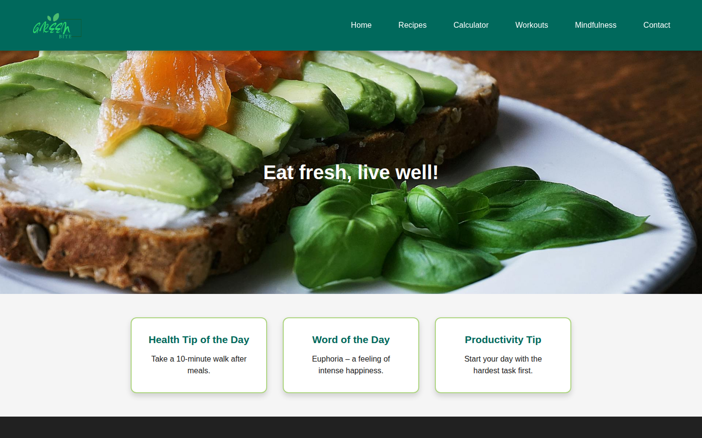
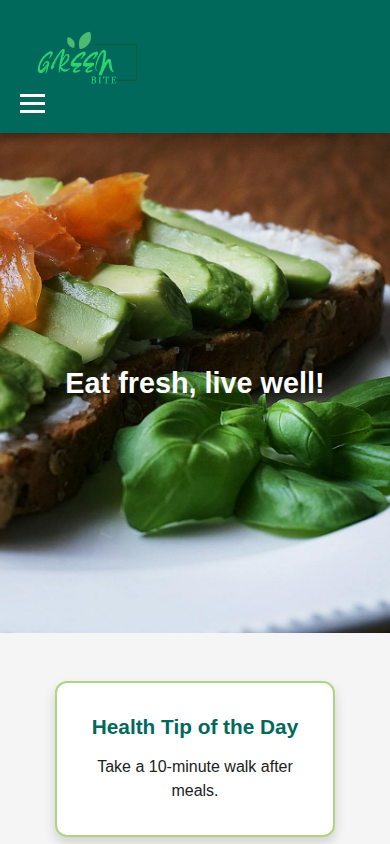
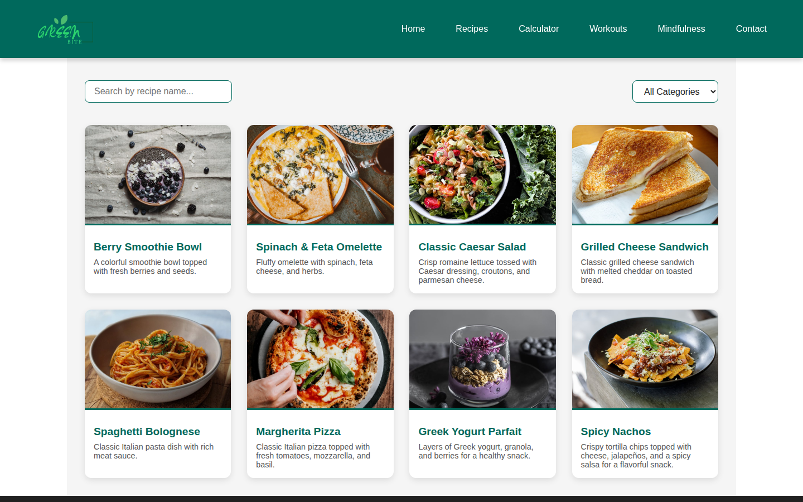
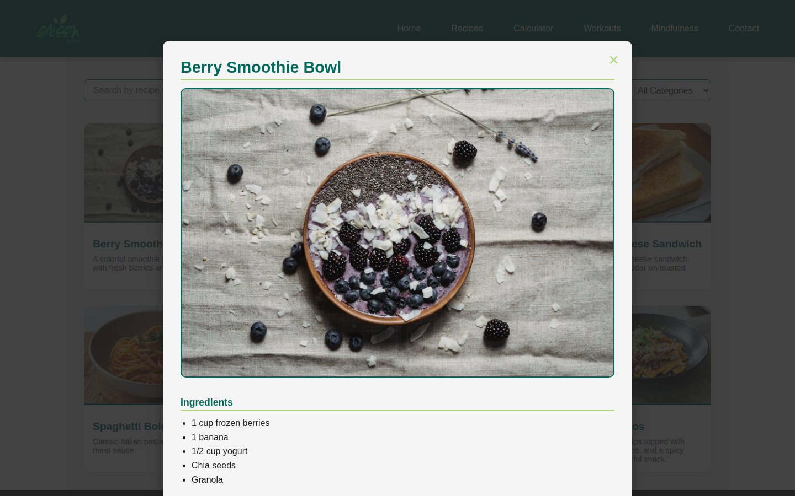
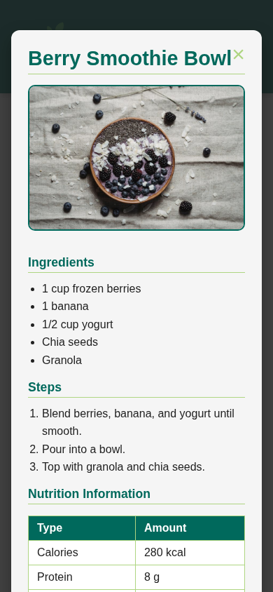
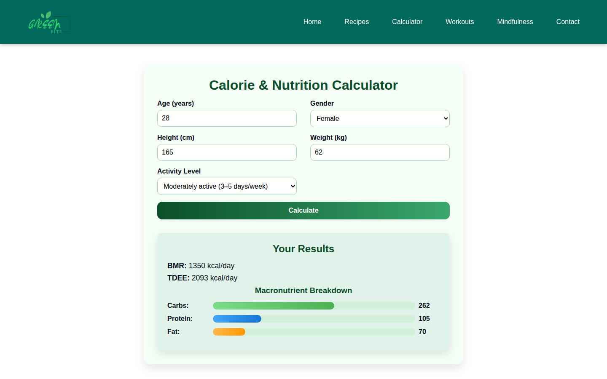
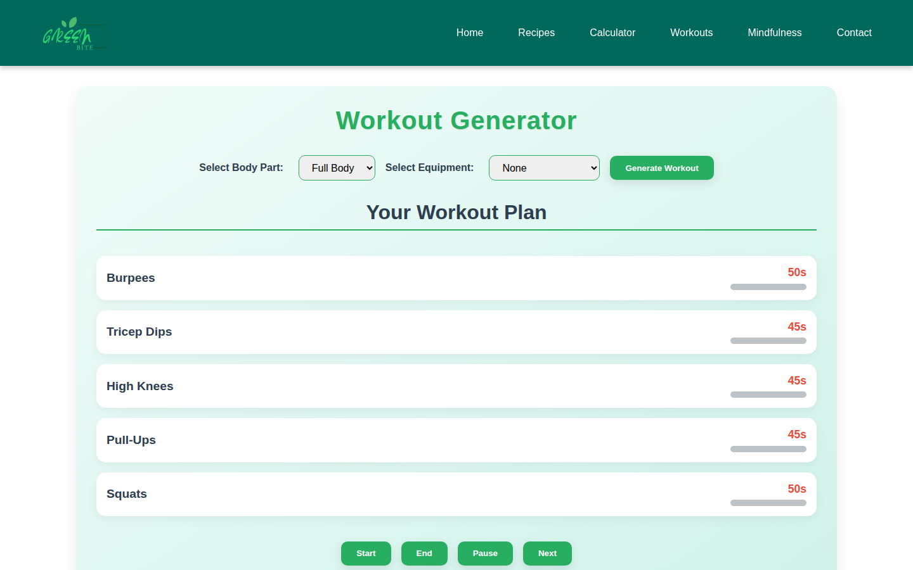
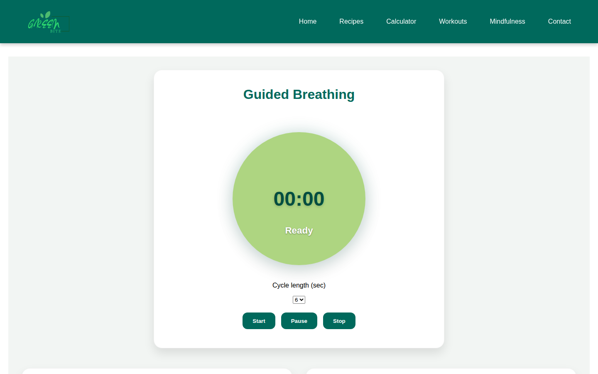
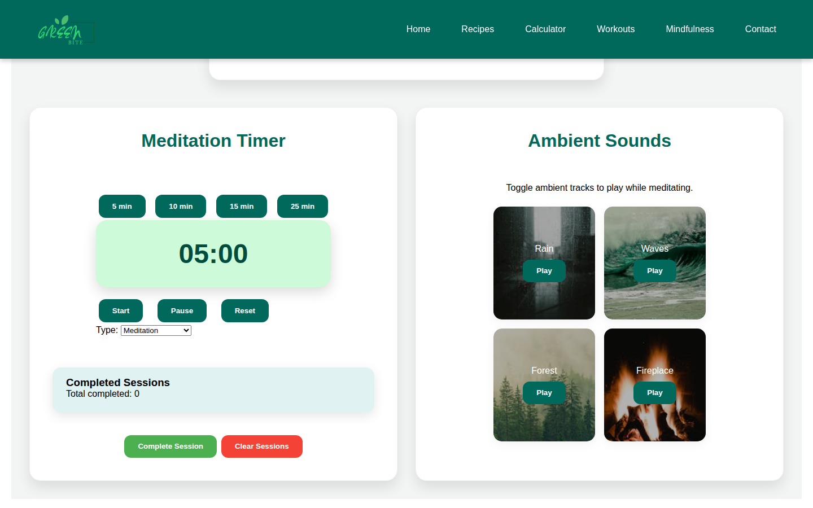
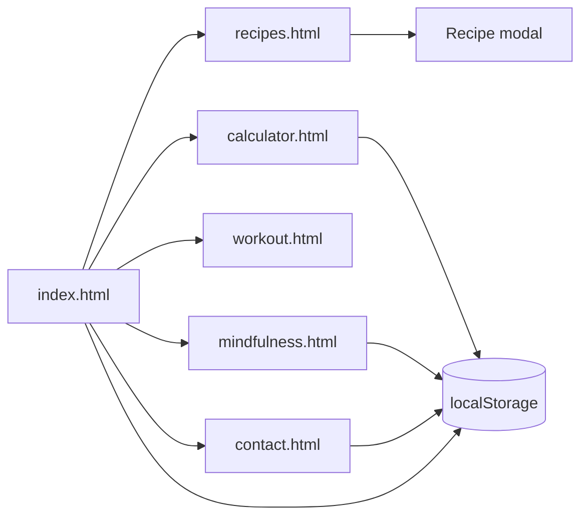

# GreenBite

GreenBite is a static website for recipes, a nutrition calculator, a workout timer, and short mindfulness tools. It runs in the browser with HTML, CSS, and JavaScript.

## Overview

There is no application server and no build step. Each page is a separate HTML file. Shared navigation, the mobile menu, and the newsletter box live in `js/scripts.js`. Page behaviour lives in the matching file under `js/`. Anything a visitor saves stays in that browser's `localStorage`. Nothing is posted to a backend.

## Links

| Resource | Location |
| --- | --- |
| Live site | [roshelpeter-cpu.github.io/GreenBite](https://roshelpeter-cpu.github.io/GreenBite/) |
| Repository | [github.com/roshelpeter-cpu/greenbite](https://github.com/roshelpeter-cpu/greenbite) |

GitHub Pages is published from the `main` branch. The lowercase path `https://roshelpeter-cpu.github.io/greenbite/` returns 404. The capitalised path above is the one that responds.

The footer social icons point at `#`. They do not open Facebook, Instagram, or Twitter profiles.

## Screenshot gallery

These captures are the site in a browser. The food and landscape pictures are the site's own image files, shown inside the pages.



















## Problem and purpose

GreenBite gathers a few everyday health tools on one small site: a recipe list, an estimate of daily calories, a short workout, and a timer for breathing or sitting quietly. It is a front-end project. It does not create accounts or store data on a server.

## Features

### Home

`index.html` and `js/home.js` rotate the hero every five seconds through three slides:

| Image | Quote |
| --- | --- |
| `assets/images/hero5.jpg` | Eat fresh, live well! |
| `assets/images/hero4.jpg` | Healthy body, happy mind. |
| `assets/images/hero3.jpg` | Stay active, stay alive. |

Health tips, words of the day, and productivity tips are fixed lists. The page picks one of each from the day of the month, using that number modulo the length of the list.

### Recipes

`recipes.html` and `js/recipes.js` ship eight recipes in the script: two breakfast, two lunch, two dinner, and two snacks. Each record has a title, category, image, description, ingredients, steps, and nutrition figures for calories, protein, carbohydrate, and fat.

- Search matches the title as the visitor types.
- The category menu filters to breakfast, lunch, dinner, snack, or all.
- Clicking a card opens a modal with the image, ingredients, steps, and nutrition table. Clicking the close control or the backdrop hides it.

The contact-page FAQ says recipes can be saved with `localStorage`. `recipes.js` does not write to `localStorage`. Saving a recipe is not implemented.

### Nutrition calculator

`calculator.html` and `js/calculator.js` estimate BMR with the Mifflin–St Jeor equations, using weight in kilograms, height in centimetres, and age in years:

- Male: `10 × weight + 6.25 × height − 5 × age + 5`
- Female: `10 × weight + 6.25 × height − 5 × age − 161`

TDEE is BMR multiplied by the selected activity factor, then rounded:

| Factor | Label |
| --- | --- |
| 1.2 | Sedentary |
| 1.375 | Lightly active, 1–3 days a week |
| 1.55 | Moderately active, 3–5 days a week |
| 1.725 | Very active, 6–7 days a week |
| 1.9 | Super active |

The macro split is 50% carbohydrate, 20% protein, and 30% fat. Grams use 4 kcal per gram for carbohydrate and protein, and 9 kcal per gram for fat. The last result is written to `localStorage` under `lastCalculatorResult`. The page does not read that value back when it loads.

### Workout generator

`workout.js` keeps 22 exercises tagged by body part (`arms`, `legs`, `back`, `full-body`) and equipment (`none`, `dumbbells`, `resistance-band`). Choosing **Full Body** keeps every body part. Choosing dumbbells or a resistance band also keeps bodyweight exercises. The generator shuffles the matches and shows five exercises, repeating the pool if it is shorter than five.

Start runs a one-second countdown for the current exercise, then moves to the next. Pause and Resume toggle that countdown. Next skips ahead. End resets the timers and highlight. The script adds the Pause and Next buttons when the page loads, next to the Start and End buttons already in the HTML.

### Mindfulness

`mindfulness.html` and `js/mindfulness.js` provide:

- Guided breathing. The cycle length is 4, 6, or 8 seconds, and the label switches between Inhale and Exhale. Start, Pause, and Stop control it.
- A meditation timer with presets of 5, 10, 15, and 25 minutes, plus Start, Pause, and Reset. The default length is 5 minutes.
- A completed-session count in `localStorage` under `completedSessions`. The meditation timer increments it when it reaches zero. **Complete Session** increments it immediately. **Clear Sessions** sets it back to zero.
- Ambient audio from `assets/sounds/`: rain, waves, forest, and fireplace. One track plays at a time. Choosing the playing track pauses it.

The session-type menu offers Meditation and Pomodoro. The script never reads `#sessionType`, so that choice does not change the timer. The empty session list in the HTML is not filled by the script. The counter is the record that is kept.

### Contact and newsletter

`contact.js` checks that name, email, and message are present, and that the email matches a simple pattern. A valid form is appended to the `feedbacks` array in `localStorage`, with the browser's local date string. The visitor sees a thank-you message. The message is not sent anywhere else.

The FAQ accordion opens one answer at a time. The page embeds a Google Maps iframe centred on Colombo.

Every page has a newsletter box. `js/scripts.js` stores the typed value in `subscribedEmail` when the field is not empty. It replaces the previous value, clears the field, and changes the placeholder to "Subscribed Successfully!" for three seconds. It does not check the email format, and it does not send the address to a server.

## How the pages fit together



## Repository structure

```text
greenbite/
├── index.html
├── recipes.html
├── calculator.html
├── workout.html
├── mindfulness.html
├── contact.html
├── css/                 One stylesheet per page, plus styles.css
├── js/                  scripts.js plus one file per page
├── assets/
│   ├── images/          Hero and ambient-sound artwork
│   ├── recipes/         Recipe photography
│   ├── icons/           Logo and social icons
│   └── sounds/          rain, waves, forest, fireplace
└── favicon/
```

There is no `package.json`, bundler, or framework.

## Prerequisites

A current browser is enough. No Node.js, database, or API key is required.

## Local setup

From the repository folder, open the home page directly:

```bash
git clone https://github.com/roshelpeter-cpu/greenbite.git
cd greenbite
```

Then open `index.html` in a browser.

A small static server is the same site, and it is useful if the browser blocks some local media:

```bash
python3 -m http.server 8080
```

Visit `http://127.0.0.1:8080/`.

There is no install step and no npm script.

## Browser storage

| Key | Written by | Contents |
| --- | --- | --- |
| `subscribedEmail` | Newsletter button | The latest typed string |
| `feedbacks` | Contact form | Array of name, email, message, and date |
| `lastCalculatorResult` | Calculator | BMR, TDEE, and macro grams |
| `completedSessions` | Mindfulness page | Integer count |

Clearing site data for the origin removes these values. They are not synced between browsers or devices.

## Testing

The repository has no automated test suite. Check the pages in a browser: search and filter recipes, open a recipe, calculate a result, generate a workout, start the breathing or meditation timer, and submit the contact form. Confirm new keys in the browser's application storage rather than in a network log.

## Limitations

- Newsletter subscriptions and contact messages stay on the device. They are not delivered to an inbox or a server.
- Recipe favourites described in the FAQ are not implemented in `recipes.js`.
- The meditation type dropdown does not change the timer.
- Social links in the footer are placeholders.
- The home page favicon markup is `href="favicon/favicon.ico"image/x-icon"`, so that icon link is not valid HTML. The favicon file itself is in `favicon/`.
- The Colombo map depends on Google's embed. The rest of the site does not.

## Author

GreenBite is published by [roshelpeter-cpu](https://github.com/roshelpeter-cpu). The footer marks the site © 2025 GreenBite. Recipe photography and ambient images are the files in `assets/`.
